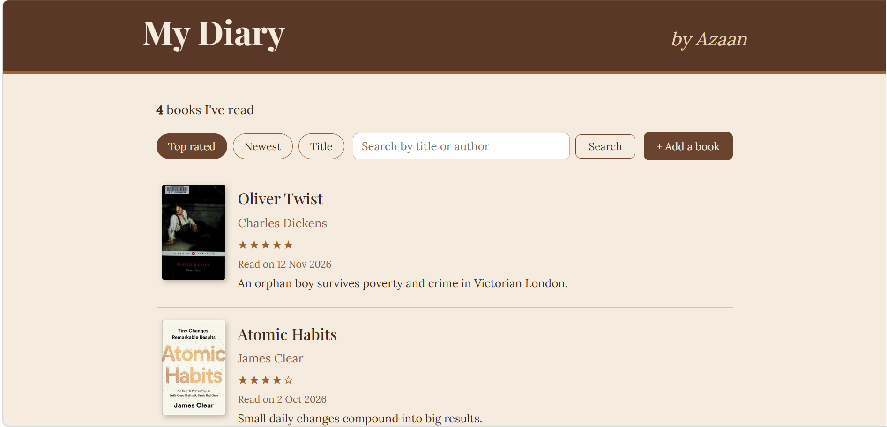
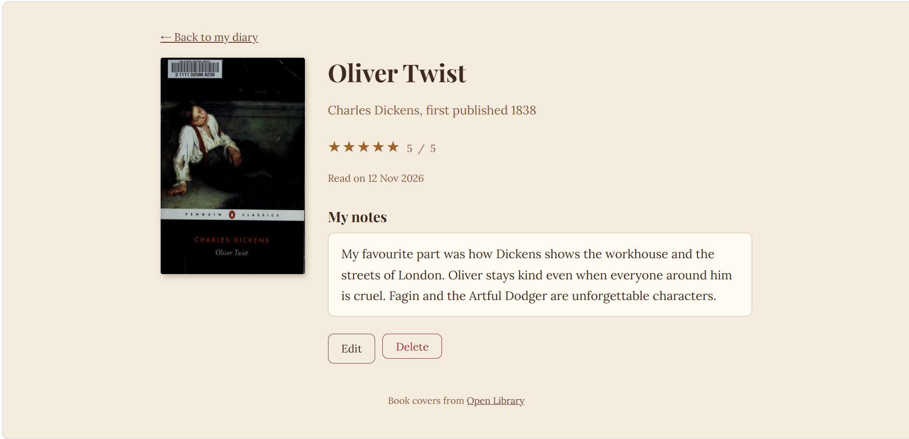

# My Diary: book notes website

A personal website where I keep the books I've read, my rating, the date, and my notes.
Inspired by Derek Sivers' book page (sive.rs/book).

**Built with:** Node.js, Express, EJS, PostgreSQL (`pg`), Axios, Open Library API (search and covers).

## Screenshots

### Front page


### Book page


## Features

- Front page with the total number of books
- Sort by **Top rated**, **Newest** or **Title**
- Search by title or author
- Click a book to see the full notes
- Add a book (search Open Library by title, or type it by hand)
- Edit a book (rating, date, notes)
- Delete a book
- Book covers from the Open Library Covers API, with a placeholder if there is none
- Error handling for the database and for the API


## How to run

1. Install [Node.js](https://nodejs.org) and [PostgreSQL](https://www.postgresql.org/download/).
2. Create a database called `book_notes` and run `schema.sql` in it (pgAdmin, Query Tool).
3. Copy `.env.example` to `.env` and put in your own PostgreSQL password.
4. Install the packages:

   ```
   npm i
   ```

5. Start the server:

   ```
   nodemon index.js
   ```

   (If `nodemon` is not found, use `npx nodemon index.js` or `npm run dev`.)

6. Open http://localhost:3000

## Project structure

```
book-notes/
  index.js            server, routes, database and API code
  schema.sql          creates the table
  .env                database settings (not uploaded to GitHub)
  views/              EJS pages (index, book, add, edit, error)
    partials/         pieces shared by pages (head, foot, cover, form fields)
  public/
    css/style.css     brown theme
    js/main.js        small front-end scripts
```
